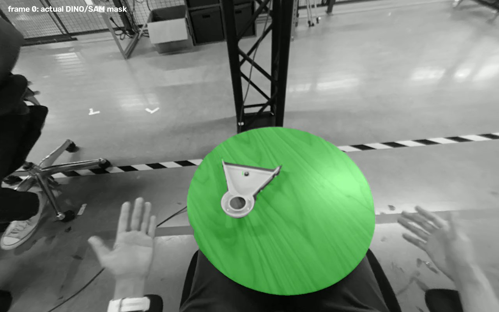
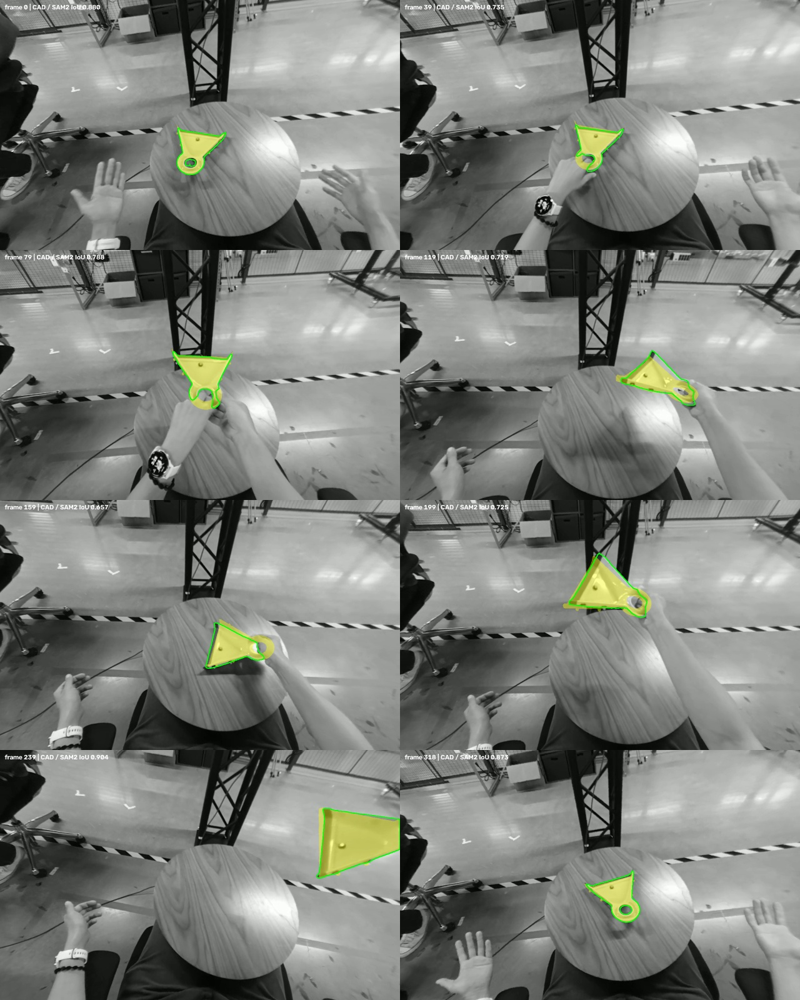

# Episode-39 GPU perception and pose control

October 4, 2026. **The current native detector reproduces the tabletop-mask failure.**
This is a new, hash-pinned public-data run, not the unidentified team run.
With one reviewed RGB box initializing SAM2 video masks, native ICP instead fits
the moving pan throughout the 319-frame clip. This remains a controlled camera-pose
experiment: automatic target acquisition and issue #5's world-pose criteria are open.

## What actually ran

The local laptop has an RTX 5060 with 8,151 MiB VRAM. A separate cache environment
uses Python 3.14, PyTorch 2.11.0+cu128, torchvision 0.26.0+cu128 and Transformers
5.18.0. CUDA 12.8 availability and a finite GPU matrix operation were verified.
The original CPU test environment remains separate. This is a local GPU run;
shared-VM access is still unknown. FoundationPose inference was not run.

Both pretrained models were downloaded as data files at fixed revisions and their
actual sizes/hashes verified against [evidence/episode39_models.json](evidence/episode39_models.json):

- `IDEA-Research/grounding-dino-base`, revision `12bdfa3120f3e7ec7b434d90674b3396eccf88eb`.
- `facebook/sam2.1-hiera-large`, revision `665f8e2ad61cf5f53d65644ff27c8ee525124610`.

Dataset revision, both stereo videos, CAD and calibration are the same pinned inputs
as the earlier frame-0 control. No object-pose GT enters these GPU commands.
Eight probe indices are fixed at 0, 39, 79, 119, 159, 199, 239 and 318, the same
indices used to inspect the supplied clip. Episode 39 is a development diagnostic;
do not present it as an untouched holdout.

## Detector failure and controlled recovery

The existing `mini dust pan.` prompt returns a table-sized box labeled **mini dust
pan** at all eight probe frames, with scores 0.506-0.694. At frame 0 SAM2 produces
149,559 mask pixels and only 0.00244 IoU against the reviewed pan outline. Because
the wrong box has the requested label, the removed unmatched-label fallback cannot
catch it. This confirms mislocalization in the current native model configuration;
it does not establish the original team's command, models or commit.

The noun-only `dustpan.` control produces zero detections at the unchanged 0.30
box / 0.25 text thresholds on all eight frames. No prompt rename or threshold
change is promoted as a fix.

The observation control initializes the **same SAM2 checkpoint's video model** once
with RGB box `[567,408,721,558]`, the bounds of the committed manual frame-0 pan
polygon. It supplies no later manual corrections, object-pose GT or GT-derived
camera. SAM2 propagates nonempty masks for all 319 frames. The first mask has
0.839 IoU against the manual outline; eight sampled overlays were visually reviewed.
The portable producer reproduces every mask's SHA-256 from the initial local control.

Native ICP consumes those frozen masks, retaining metric scale 1, 6,000 CAD samples,
CAD seed 0, default trimmed ICP, warm starts, no smoothing and the original 50 mm
residual gate. The recorded run accepts 319/319 camera observations. Sampled full
mesh renders have CAD/SAM2 silhouette IoU 0.657-0.904. These overlaps and small ICP
residuals are fit diagnostics, not translation/rotation error against truth.

Residual median/max are 6.23/14.04 mm. The maximum raw camera-pose rotation
increment is 15.58 degrees, with zero increments above 90 degrees. The final
portable replay reproduces all 319 masks and all 319 fitted transforms exactly.

The actual default mask at frame 0:



Eight controlled fits, green SAM2 outline and yellow CAD:



The GPU receipt records the final source, commands, coverage, residual and rotation
increment summaries, raw pose hashes, mask/model hashes and eight depth/overlay
checks. No >90-degree camera-pose increment is observed in this sequence; camera
increments include true object motion and egomotion and are not motion error.

## Software changes and test boundary

Software commit `45a9fc5` adds `register_poses.py --mask-manifest` so an operator can
freeze observations and bypass DINO/SAM. The reader requires exact episode/object
order, rectified camera identity, resolution, calibration hash, R1/R2/P1/P2/Q and
declared GT-use. Each loaded binary PNG is hash-checked. Missing masks remain gaps;
changed bytes, incompatible geometry or undeclared/GT-assisted masks in `--no-gt`
fail. Output poses preserve the manifest and mask hashes and producer information.
Prepared observations are optional; the faulty automatic detector remains the default.

All rejection paths now clear native warm starts. A source frame gap also triggers
global registration; consecutive accepted observations can warm-start. The report
records each warm-start source ID, the executed source hash, runtime and CAD seed.
Four new gap controls failed before this fix. With prepared-mask contract controls,
**145 targeted CPU tests pass, zero skips**. These CPU cases use generated fixtures;
the GPU records above separately establish actual model and registration execution.

## Reproduce on a compatible GPU environment

From this checkout, create a separate environment or use an existing compatible one.
The tested Windows package setup is:

```bash
python -m pip install torch==2.11.0 torchvision==0.26.0 --index-url https://download.pytorch.org/whl/cu128
python -m pip install transformers==5.18.0 opencv-python==5.0.0.93 trimesh==5.1.1 scipy==1.18.1 pyarrow==25.0.1 pandas==3.0.6
```

The models/outputs can live in an external cache. Set the following to actual paths;
every run output must be fresh. On PowerShell, replace shell variables/export with
PowerShell variables and `$env:V2D_PUBLIC` / `$env:V2D_CALIB`.

```bash
DATA=/absolute/episode39-public
MODELS=/absolute/issue5-model-cache
RUN=/absolute/fresh/episode39-control
python scripts/fetch_track3_assets.py --episodes 39 --output "$DATA"
mkdir -p "$DATA/meta"
cp tests/fixtures/track3_camera_calibration.json "$DATA/meta/camera_calibration.json"
python scripts/fetch_issue5_model_inputs.py --output "$MODELS"
python scripts/eval/probe_issue5_pan_masks_gpu.py \
  --data "$DATA" --models "$MODELS" --out "$RUN/native-probe"
python scripts/eval/probe_issue5_pan_masks_gpu.py \
  --data "$DATA" --models "$MODELS" --prompt dustpan --out "$RUN/noun-probe"
python scripts/eval/prepare_issue5_pan_masks_gpu.py \
  --data "$DATA" --models "$MODELS" --out "$RUN/masks"
export V2D_PUBLIC="$DATA"
export V2D_CALIB="$DATA/meta/camera_calibration.json"
python scripts/track3/register_poses.py --episode 39 --no-gt --objects mini_dust_pan \
  --mask-manifest "$RUN/masks/manifest.json" --out "$RUN/poses" --seed 0 --log 40 \
  --cloud-filter radial
python scripts/eval/render_issue5_pan_control.py --data "$DATA" \
  --masks "$RUN/masks" --depth-probe "$RUN/native-probe" --poses "$RUN/poses" \
  --out "$RUN/overlays" --video
```

The prepared-mask producer emits `manifest.json`, 319 binary mask PNGs, a tracking
receipt and eight mask overlays. `--frames` can bound a smoke test without claiming
full coverage. The model fetcher bounds downloads to 2 GB and verifies every actual
file against committed hashes; it does not download executable model code.
The renderer checks pose/mask hashes, writes eight z-buffer diagnostics and can
produce a 319-frame, 20 FPS control video, decoded and frame-count checked locally.
Video display uses the full projected triangle silhouette; numeric depth checks
use the frontmost z-buffer. The clip is a visualization of this camera-space control.
The image SAM2 loader warns that the checkpoint type is `sam2_video`; the video
control uses `Sam2VideoModel`, including the checkpoint's temporal memory weights.
No FoundationPose or robot-training runtime is installed by these commands.

### Cloud-filter regression

The subsequent density-filter regression retains the same frozen 319 SAM2 masks:
319/319 accepted observations, median/max residual 6.24/15.34 mm, no >90-degree
increments, and sampled CAD/SAM IoU 0.658–0.904. See
[CLOUD_AND_POSE_SUPPORT.md](CLOUD_AND_POSE_SUPPORT.md) for the filter, sampled
pot improvements and remaining rotation failures. The native CLI now defaults to
`local_density`; the command above explicitly selects `radial` for historical
replay. Neither run establishes automatic target acquisition or world accuracy.

## Remaining requirements

Manual initial target selection is an explicit dependency of this control. It is not
fully automatic recovery. The default detector still selects the table; a production
target-acquisition strategy must be validated on separate development sequences.
This run supplies source frame IDs but no independent camera trajectory or capture
times (`timestamp` is null without `--frame-times`). Supply a verified time receipt
and one shared metric `C(t)` before fixed-world conversion/scoring.

Stereo has no independent depth truth. Full projected silhouette overlap does not
independently label hand occlusion or prove canonical orientation. Original team
artifacts remain missing; all-20 accuracy, both pot cameras, cross-object RPE and the
original issue acceptance gates are unmeasured. FoundationPose remains a proposed
comparison after target acquisition, rather than an executed experiment or replacement.
Keep PR #30 draft and issue #5 open. Do not merge to main on this evidence.
