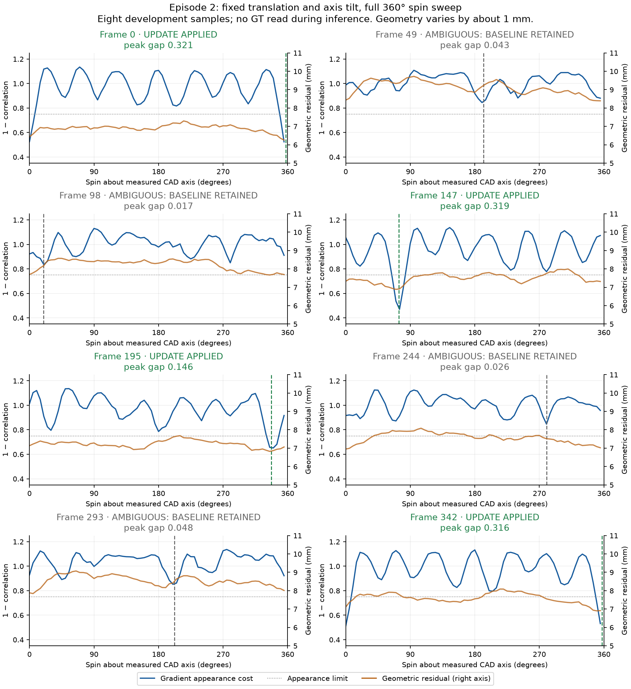
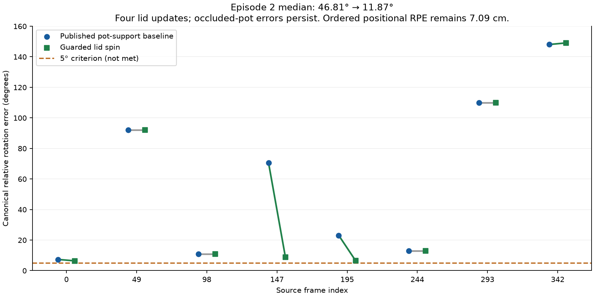

# Lid appearance and episode-0 replication

October 4, 2026. The optional fixed-axis lid diagnostic improves sampled relative
rotation, but **canonical rotation and automatic tracking still fail**. Keep PR
#30 draft and do not merge to main. This follows [CLOUD_AND_POSE_SUPPORT.md](CLOUD_AND_POSE_SUPPORT.md).

## Method and failed controls

The solver already estimates 6D pose. This experiment addresses one remaining
orientation ambiguity using the scanned lid's asymmetric markers; it does not
replace the tracker or run FoundationPose. The CAD extents are approximately
0.047 × 0.188 × 0.190 metres. Its measured minimum-variance axis is
`[0.999954, 0.007215, -0.006297]`, close to CAD +X.

The diagnostic sweeps this axis through 360 degrees in 5-degree steps, then
refines the best appearance peak at 0.5-degree steps. Translation and the
camera-space axis tilt remain fixed. The planar CAD texture uses a 35–86 mm
annulus, excluding the rim and handle centre. It approximates the marker-bearing
front face rather than rendering full photometric mesh geometry.

Raw high-pass grayscale correlation failed: median canonical relative rotation
became **89.87°**, versus **46.81°** for the frozen baseline on the same eight
episode-2 samples. CAD/video marker brightness differs in polarity. Gradient
magnitude avoids that dependency. Repeated markers or missing texture still
cannot resolve spin; a designated back face cannot authorize an update.

An update requires appearance cost ≤0.75 and a cost gap ≥0.1 against the best
alternative at least 30 degrees away. These experimental guards were fixed before
the guarded episode-2 evaluation and used unchanged on episode 0. They are not
independently calibrated confidence probabilities. Ambiguous samples retain the
baseline and record `uncertain_baseline_retained` and the reason. A geometrically
invalid proposal also retains the baseline; a final invalid pose is rejected.

Every applied pose has a freshly recomputed native symmetric 60%-trimmed residual,
using the same seed-zero fine CAD indices and frozen depth/filter. On episode 2,
geometry varies only about 0.85–1.33 mm across the full spin sweep. Choosing its
coarse minimum alone gives 24.18° median relative rotation. That derived geometric
control is exploratory, without symmetry-reduced credit or a tracking claim.



## Matched results, including failures

Each row uses eight predetermined samples, rectified ego_cam_c, RGB-reviewed SAM2
prompts, pot/lid mask exclusion and frozen SGBM/CAD/calibration. Inference reads
no pose GT. A separate evaluator checks frozen predictions against public GT and
the pinned participant RPE kernel. Every row retains 8/8 GT-visible accepted
pairs, including large errors. Episodes 0 and 2 are development data, not holdouts.

| Episode | Configuration | Ordered positional RPE | Median relative translation | Median canonical relative rotation |
| --- | --- | ---: | ---: | ---: |
| 2 | Density baseline + projected-support pot; lid frozen | 7.09 cm | 2.55 cm | 46.81° |
| 2 | Same pot + guarded lid appearance | 7.09 cm | 2.55 cm | **11.87°** |
| 0 | Reviewed-mask / radial baseline | 21.40 cm | 16.97 cm | 119.29° |
| 0 | Density filter; both objects refit | 13.31 cm | 11.75 cm | 139.59° |
| 0 | Projected-support pot; density-baseline lid frozen | 4.43 cm | 3.12 cm | 120.09° |
| 0 | Same pot + unchanged guarded lid appearance | **4.43 cm** | **3.12 cm** | **72.66°** |

Episode 2 updates lid frames `[0,147,195,342]` and retains the baseline at
`[49,98,244,293]`. Episode 0 updates `[159,213,372]` and retains the baseline at
`[0,53,106,266,319]`. The lid stage leaves pot poses unchanged. Ordered first-slot
pot-to-lid positional RPE therefore stays unchanged; the reverse relative-position
direction can change when the lid rotates. Both directions are recorded.



Episode-0 source IDs are `[0,53,106,159,213,266,319,372]`. Prompts were reviewed
from all eight RGB images before scoring this control. Their JSON binds the exact
native observation report, calibration, object order, episode and decoded
rectified BGR pixels. Missing/extra frame prompts and changed RGB are rejected;
local review PNGs are not needed on the next operator's machine. Masks still lack
independent human review and visible-surface/occluder truth.

Adding external annotations preserves the original episode-2 default: the actual
rerun gives **32/32 prompted/final PNGs byte-identical**, all **16 fits and eight
frame records exact**. Both final portable lid runs reproduce every fit and
spin-curve sample of their prototypes. Episode 0 retains all 200 pot hypotheses;
native three-seed translation replay error is zero on every frame.
**156 CPU tests pass, zero failures/errors/skips**. Six new controls cover marker
polarity, ambiguous texture, backside visibility, axis tilt/fresh residuals and
annotation identity/coverage. The lid worker executes OpenCV/SciPy and fine-sample
RNG on CPU within the pinned environment, separately from upstream GPU fitting.

## Reproduce and review

Use the pinned assets/environment from [GPU_CONTROL.md](GPU_CONTROL.md) and the
native observation probe from [POT_CONTROL.md](POT_CONTROL.md). `NATIVE` contains
the eight frozen depth files per episode. Outputs must be fresh.

```bash
# Episode 0; omit --annotations for the historical episode-2 control.
python scripts/eval/probe_issue5_pot_mask_control.py \
  --data "$DATA" --models "$MODELS" --baseline "$NATIVE" \
  --annotations docs/team/issue5/evidence/lid_spin/e000/annotations.json \
  --out "$RUN/visible"
python scripts/eval/probe_issue5_cloud_filter.py \
  --data "$DATA" --observations "$RUN/visible/probe_results.json" \
  --depth-root "$NATIVE" --filter local_density --out "$RUN/density"
python scripts/eval/probe_issue5_pose_candidates.py \
  --data "$DATA" --observations "$RUN/density/probe_results.json" \
  --masks "$RUN/visible" --depth "$NATIVE" --out "$RUN/support"
python scripts/eval/probe_issue5_lid_spin.py \
  --data "$DATA" --observations "$RUN/support/probe_results.json" \
  --masks "$RUN/visible" --depth "$NATIVE" --score gradient_ncc \
  --minimum-gap 0.1 --maximum-cost 0.75 --out "$RUN/lid-spin"
# Freeze predictions before this separate GT-only evaluator.
python scripts/eval/evaluate_issue5_pot_relative.py \
  --data "$DATA" --predictions "$RUN/lid-spin/probe_results.json" \
  --kit "$KIT" --out "$RUN/lid-spin-relative.json"
python scripts/eval/render_issue5_pot_control.py \
  --data "$DATA" --observations "$RUN/lid-spin/probe_results.json" \
  --masks "$RUN/visible" --out "$RUN/lid-spin-overlays"
```

External annotations bind the original native report bytes. A regenerated report
with different runtime metadata has a different hash. For replay, use committed
`evidence/lid_spin/native_observations.json` as `NATIVE/probe_results.json`, with
regenerated hash-matching depths. Do not edit the receipt or bypass mismatches.
The native input/depth regeneration is documented in POT_CONTROL.

New appearance previews label observed, proposed and applied poses. Full-mesh
overlays use actual applied poses. Older local two-panel prototype images showed
the proposal even when withheld; they cannot be read as the exported pose. Final
eight-frame overlays for both episodes were reviewed. Displaced/rotated pot fits
remain, especially on stacked samples. Raw grayscale/geometry-only controls have
limited producer provenance and are explicitly exploratory; the current guarded
CLI validates input hashes and freshly computes applied-pose residuals.

## Remaining work

These are sampled relative measurements, without world-pose or policy-rollout
accuracy. Episode-0 rotation remains 72.66°; neither episode meets the 5° criterion
or proves the two-camera pot requirement. A symmetric outline or small trimmed
residual cannot adjudicate canonical orientation.

Next isolate lid tilt/translation and the planar-texture approximation, then
assess frontmost depth/CAD support and occlusion for remaining pot hypotheses.
Preserve failures and uncertainty. Continuous motion/increment/lag/gap checks,
independent mask/depth review, shared independent C(t), original prepared-pipeline
regeneration, all-20 reports and both pot cameras remain open. No FoundationPose
inference, robot training, rollout submission or merge was performed.
