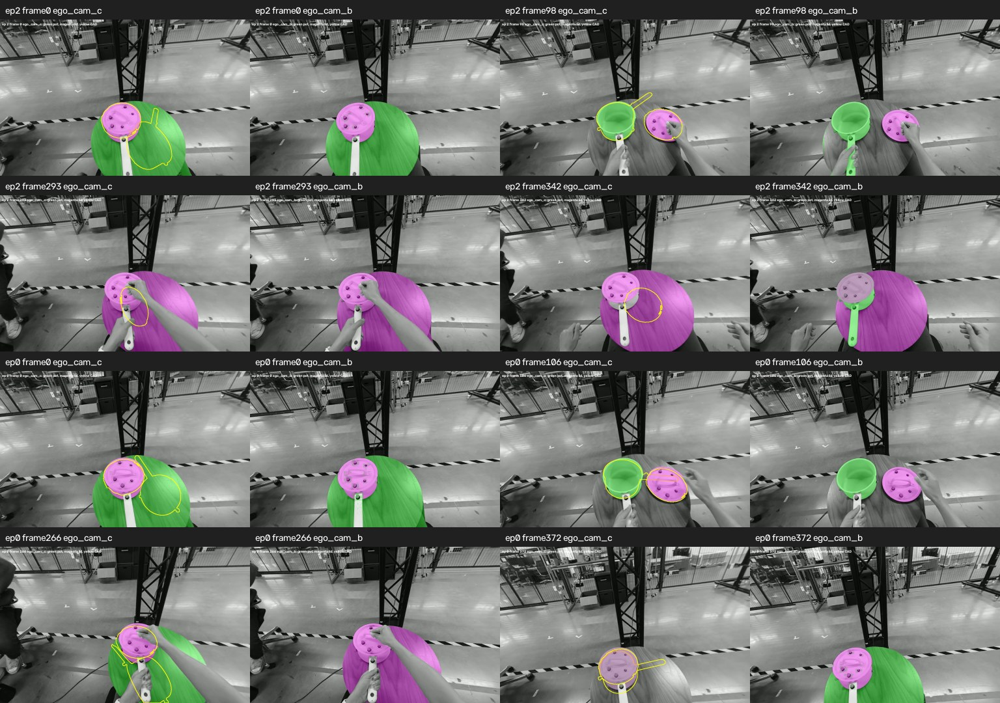

# Public pot/lid observation and relative-pose control

October 4, 2026. **The primary pot failure is still present in the native pipeline.**
This control adds actual episode-2/0 model/geometry evidence after the episode-39
reviewed-box recovery. It does not reproduce the unidentified team run or establish
recovery of the prepared FoundationStereo/point-to-plane pipeline.

## Frozen experiment

The same hash-verified DINO/SAM2 checkpoints and local RTX 5060 environment from
[GPU_CONTROL.md](GPU_CONTROL.md) run the exact native prompt
`white pot. white pot lid.` at unchanged 0.30 box / 0.25 text thresholds. Input
RGB/CAD bytes match the pinned public asset manifest; calibration matches the
committed public fixture. No object-pose GT is read during inference.

Selection is eight rounded linspace source indices per complete video, before GT
evaluation: episode 2 `[0,49,98,147,195,244,293,342]`, then episode 0
`[0,53,106,159,213,266,319,372]`. Both rectified camera masks are generated; native
SGBM depth and scale-1 ICP are fitted in the rectified left camera (`ego_cam_c`).
Global registration is used independently at each sampled frame, with 6,000 CAD
samples/seed 0, no warm starts, no smoothing and the existing 50 mm residual gate.
These sparse samples cannot measure continuous tracking/temporal coverage.

## What failed

| Episode | Pot accepted | Lid accepted | Accepted pot fits with CAD/model-mask IoU <0.5 |
|---|---:|---:|---:|
| 2 | 6/8 | 6/8 | 2 |
| 0 | 8/8 | 8/8 | 4 |

Early pot masks select much of the tabletop in both episodes. Their accepted
residuals are about 36-42 mm, despite CAD/mask IoU only 0.19-0.33. At episode 2
frames 293 and 342 the left pot mask is empty, while a table-sized lid mask fails
the residual gate. At episode 0 frame 372 the two masks nearly coincide and feed
the same cloud to different CADs. All rejected/missing cases remain in the receipt.
Overlap below 0.5 is a reporting stratum here, not a new tuned production threshold.

The fixed language controls compare individual `white pot.`, `cooking pot.`,
`saucepan.`, `white pot lid.` and `pot lid.` at the first, third and last selected
frames in both episodes. They yield table contamination, mixed pot/lid unions or
missing detections. In particular, `saucepan.` finds no box at either first frame.
Single-object prompts can label both the lid and table with the requested phrase,
then union their masks. No prompt rename or higher threshold is promoted as a fix.

## Evaluation after prediction freeze

Only after the camera observations are frozen does the separate evaluator read
hash-verified public parquet poses/visibility. Frame IDs select GT rows explicitly,
and object names select slots. Within-frame relative transforms cancel a camera
shared by both objects; an independent camera is therefore unnecessary for this
bounded relative diagnostic. This does not produce fixed-world trajectories.

| Episode | Common visible accepted samples | Official RPE kernel, cm | Median canonical relative rotation error, degrees |
|---|---:|---:|---:|
| 2 | 6/8 | 41.00 | 144.83 |
| 0 | 8/8 | 24.81 | 144.98 |

RPE above is the participant kit's positional kernel, with an independently checked
adapter result and constant-gauge invariance. Relative rotation is a separate
diagnostic, not an orientation component of official RPE. Both pair directions
are retained in the raw evaluation. Selection is conditional on common GT visibility
and accepted observations; the two missing/rejected episode-2 samples stay visible
in the denominator. No fill, smoothing or rejected pose is scored as observed.

This is a fresh measurement using corrected quaternion/center conventions. It does
not reinstate the earlier retracted PR #28 rotation diagnosis. It shows that low
fit residuals and plausible projections can coexist with incorrect relative 6D
geometry. It does not yet attribute canonical error to symmetry, visibility,
depth, optimization, scan-frame alignment or a particular original team run.

## Software and receipts

Software `f8bc24f` extends native `registration_report.json` with
`detection_candidates`: every box in rectified image coordinates, assigned object
or null, raw text label/score and individual SAM mask pixel count. The legacy
assignment list remains. Each frame resets candidates, including zero-detection
frames. Masks/acceptance behavior is unchanged; this is an observation-lineage fix.
The 145-test CPU suite passes with zero skips, including strengthened candidate
capture/reset and report-persistence checks. Actual GPU executions are separate.

The portable probes emit binary mask/depth observations, per-view boxes and counts,
unfilled fits, full-mesh z-buffer overlays and exact source/model/input hashes.
The relative evaluator binds its output to the frozen prediction hash and rejects
a participant RPE source different from the verified kit. Receipts and preview
are listed in [evidence/README.md](evidence/README.md).

## Replay

Use the separate GPU environment described in GPU_CONTROL.md. The world-calibration
module is also needed by the renderer/evaluator:

```bash
python -m pip install --no-deps -e reconstruction/modules/v2d_world_calib
DATA=/absolute/public-with-episodes-0-and-2
MODELS=/absolute/pinned-issue5-model-cache
KIT=/absolute/verified/v2d_submission_kit
RUN=/absolute/fresh/pot-control
python scripts/fetch_track3_assets.py --episodes 0,2 --output "$DATA"
mkdir -p "$DATA/meta" "$DATA/data/chunk-000"
cp tests/fixtures/track3_camera_calibration.json "$DATA/meta/camera_calibration.json"
BASE=https://huggingface.co/datasets/nvidia/video_to_data_challenge/resolve/5f68335f3acc802033d1e80728c1633197521de8/track_3/public
curl -fL "$BASE/meta/info.json" -o "$DATA/meta/info.json"
curl -fL "$BASE/data/chunk-000/episode_000000.parquet" -o "$DATA/data/chunk-000/episode_000000.parquet"
curl -fL "$BASE/data/chunk-000/episode_000002.parquet" -o "$DATA/data/chunk-000/episode_000002.parquet"
python scripts/fetch_issue5_model_inputs.py --output "$MODELS"
python scripts/eval/probe_issue5_pot_observations.py \
  --data "$DATA" --models "$MODELS" --out "$RUN/native"
python scripts/eval/probe_issue5_pot_language.py \
  --data "$DATA" --models "$MODELS" --baseline "$RUN/native/probe_results.json" \
  --out "$RUN/language"
python scripts/eval/run_issue5_pot_native.py \
  --data "$DATA" --models "$MODELS" --out "$RUN/native-cli-smoke"
python scripts/eval/evaluate_issue5_pot_relative.py \
  --data "$DATA" --predictions "$RUN/native/probe_results.json" --kit "$KIT" \
  --out "$RUN/relative.json"
```

Get the pinned videos/CAD using `scripts/fetch_track3_assets.py --episodes 0,2`
and use `scripts/fetch_issue5_model_inputs.py` for models. The evaluator also needs
the pinned episode-0/2 public parquets and `meta/info.json`. Every output is fresh;
evaluation does not alter inference. Exact local commands/environment and source
hashes are in the validation receipt.

## Remaining work

### RGB-prompted mask / 6D-pose follow-up

The next episode-2 control keeps the same eight source IDs, frozen SGBM depth
bytes, metric CAD, seed-0 samples, native solver and 50 mm gate. Per-frame SAM2
boxes/foreground/background points are chosen from rectified RGB, including the
visible pot handle and hand/lid exclusions. These are Codex-reviewed development
annotations, not independently verified ground-truth masks. In four stacked
frames SAM2 still includes the lid in the pot mask; the published control removes
lid-mask pixels from the pot observation. Hands/uncertain boundaries may remain.
No GT pose enters the producer, and evaluation runs separately after freeze.

On the **same six source IDs accepted by the native baseline**:

| Observation control | Mean pot-to-lid relative position error, cm | Median canonical relative rotation error, degrees |
|---|---:|---:|
| Native detector/SAM2 | 41.00 | 144.83 |
| RGB prompts, lid overlap excluded | 32.90 | 153.38 |

The lid-excluded control accepts all eight pot/lid fits. Across those eight, the
participant RPE kernel is **29.00 cm**, median canonical relative rotation error
is **165.95 degrees**, and pot/lid median fit residuals are **17.29/7.19 mm**.
The eight-frame score has a different denominator from the native six-frame score;
it must not be presented as a matched-frame improvement. The first prompted-only
control also fails orientation, and is retained in the validation comparison.

All sixteen prompted masks reproduce the initial control exactly; every depth
file retains its baseline hash. All eight overlays were inspected. Uncovered-pot
frames still show several CAD handles pointing away from the observed handle.
Stacked/partially visible pot fits also fail. Full-CAD silhouette IoU against a
mask with external occluders removed is not visible-mask accuracy. These results
do not establish that masks are correct, isolate depth/scan-frame/symmetry effects,
or demonstrate a complete tracking repair.

**6D pose is already the current output contract.** The comparison shows why
target acquisition alone is insufficient to validate that pose. FoundationPose
is worth a bounded initialization/recovery comparison because it adds learned
RGB/geometry refinement and scoring, potentially using visible asymmetric cues
that trimmed geometric fitting fails to align. This is a method-based hypothesis,
not measured FoundationPose improvement. Its repository source is present, but
`nvdiffrast`, `warp` and `kaolin` are absent from the isolated GPU environment;
FoundationPose inference remains unrun. The accepted tracker is unchanged.

Replay after producing the native baseline above:

```bash
python scripts/eval/probe_issue5_pot_mask_control.py \
  --data "$DATA" --models "$MODELS" --baseline "$RUN/native" \
  --out "$RUN/visible-mask-control"
python scripts/eval/evaluate_issue5_pot_relative.py \
  --data "$DATA" --predictions "$RUN/visible-mask-control/probe_results.json" \
  --kit "$KIT" --out "$RUN/visible-mask-relative.json"
```

Raw predictions, evaluator-only GT binding, replay checks and the exact executed
source/runtime hashes are in `evidence/pot_visible_mask_*.json`. This is eight
development frames in the left camera, without continuous tracking, independent
mask/depth truth or world-camera estimation. No production acquisition, threshold,
rotation prior or method is changed.

Sampled masks in both views, with left-camera CAD contours:



Correct and independently review target/occluder observations before trusting pose
acceptance. Retain the frozen baseline; compare mask and depth changes separately
and assess visible features/axis/spin before changing rotation priors. A residual
gate or prompt change alone does not recover tracking. Evaluate any FoundationPose
initialization on the same corrected observations and canonical relative geometry;
its inference remains unrun.

Neither both-camera absolute pot error nor all-20 world-pose accuracy is measured.
Independent shared metric C(t), original prepared mask/FS-depth producers/artifacts,
full raw coverage and official policy-rollout provenance remain absent. This is
pipeline-C public diagnosis, not the required pipeline-A/B regeneration, full kit
`score()` submission, all evaluation configurations or robot-training evidence.
Keep issue #5 open and PR #30 draft. Do not merge to main.
